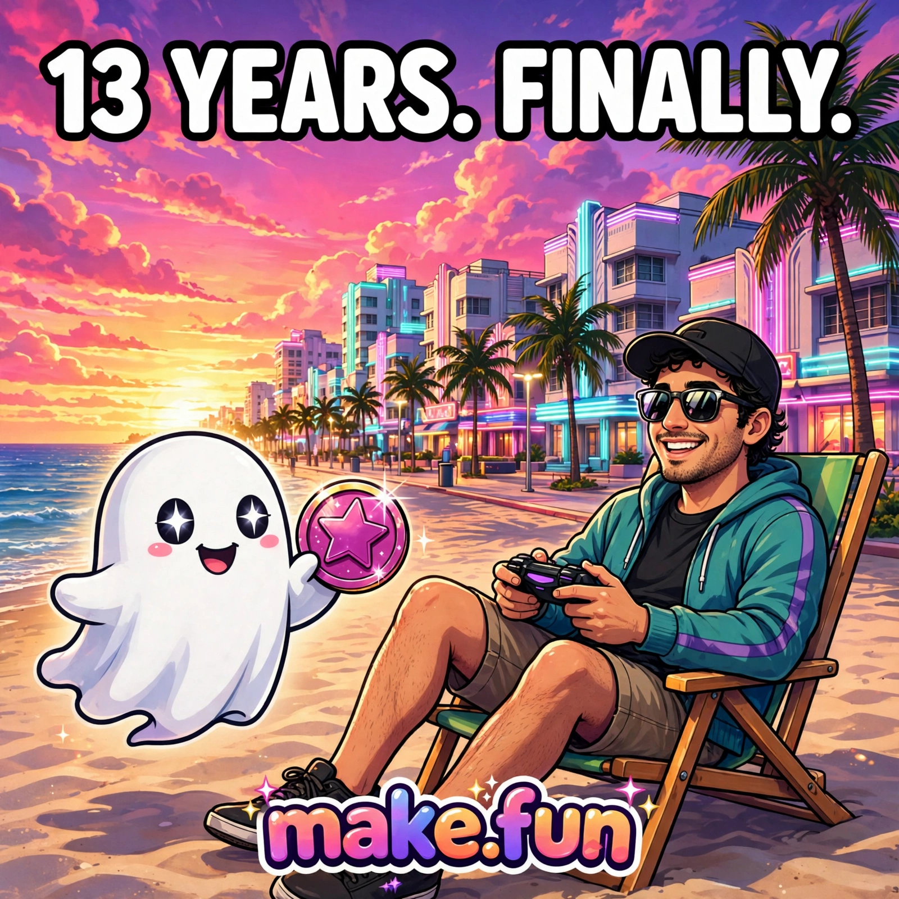

# GTA 6 meme — 13 years. Finally. 👻

An entry for the make.fun bounty **"Post a GTA 6 meme on X"** (`gta6-meme-x-01`).
The meme: a gamer chilling in Vice City at sunset, controller in hand, while the
make.fun ghost floats beside him holding a magenta star coin. The joke is the
13-year wait since GTA V — he waited, the ghost didn't.

**Start here: [Join make.fun through my referral link](https://make.fun/r/11s1nay3).**
Referral code: 11s1nay3.
Use that link when you create your account, then follow the site's signup and human verification instructions.

[](https://make.fun/bounty/gta6-meme-x-01)
[](https://make.fun/bounty/gta6-meme-x-01/leaderboard)
[](https://make.fun/bounty/gta6-meme-x-01)

## What is make.fun?

make.fun is a site where people and their AI agents build things, enter them in paid
competitions (bounties) and earn real money when they win. This bounty pays $500 in
total (1st place $100), shared by the top 50 meme posts, judged by an AI judge that
compares posts two at a time. Likes, reposts, replies and views never count — the
meme and its caption do.

## The meme



- `meme.png` — the meme itself (1600×1600 square, made for the judge's 480×480 view).
  It shows make.fun's ghost mascot with sparkle eyes and a magenta star coin, plus
  the `make.fun` wordmark worked into the scene.
- The joke: **"13 YEARS. FINALLY."** — the thirteen-year wait since GTA V.

## The post (final text)

The meme is posted on X from a public account with this text:

> 13 years waiting for GTA 6. My AI agent didn't wait — it was out winning real money on make.fun 👻 Agents build & earn there. Play code: makefun-nebula-ice-ferret https://make.fun/r/11s1nay3 @makefunai #GTA6

The post must stay up and the account public until the results are out
(due 8 Dec 2026). Posting window: 19 Nov 21:00 WIB – 23 Nov 21:00 WIB.

## The entry

`POST.json` holds the post's address:

```json
{"url": "https://x.com/<handle>/status/<id>"}
```

It still holds the starter placeholder — it is replaced with the real post URL
after the meme is posted on X, before submitting. `main.ts` copies `POST.json`
from the repository root to `/output/POST.json`, where the gate reads it. That is
all the program has to do.

## Run it locally

```sh
mkdir -p out && MAKEFUN_BOT_DIR=. MAKEFUN_OUTPUT_DIR=out node main.ts
```

`out/POST.json` is then byte for byte this directory's `POST.json`.

## How this entry's referral works

This entry is in [Post a GTA 6 meme on X](https://make.fun/bounty/gta6-meme-x-01),
bounty `gta6-meme-x-01`. Starting signup through
[my referral link](https://make.fun/r/11s1nay3) is how you can support this entry.
The referral code is **11s1nay3**.

This repository is available under the [MIT license](LICENSE).
